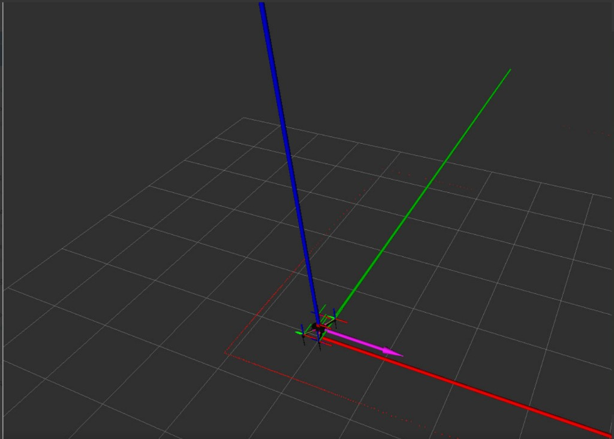
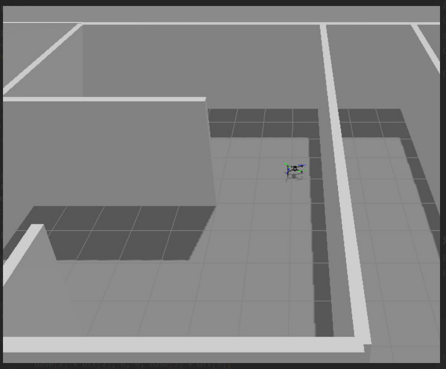
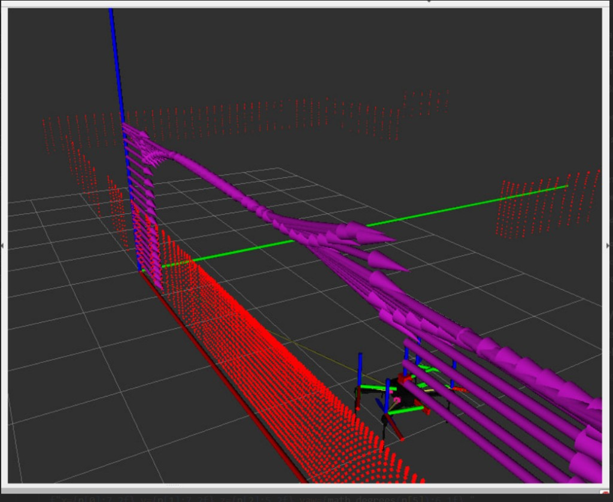
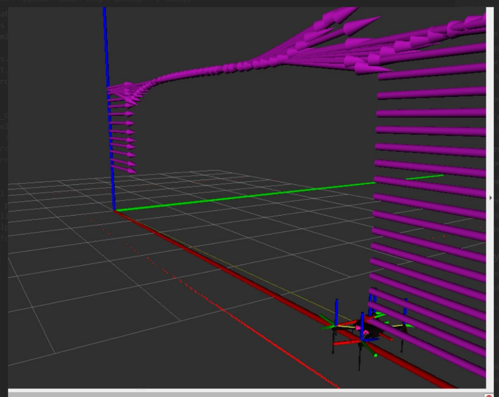

# Лабораторна робота №2

**Керування польотом БПЛА в симуляторі ArduPilot SITL + Gazebo + ROS 2**

Варіант **3**: \(\Delta x = 6{,}4\) м, \(\Delta y = -0{,}1\) м.

---

## 1. Мета роботи

- Налаштувати симуляційне середовище ArduPilot SITL, Gazebo Harmonic і ROS 2 Jazzy.
- Відтворити еталонний політ: зліт, зависання, посадка.
- Реалізувати власний алгоритм польоту в індивідуально призначену точку лабіринту і приземлитися з похибкою не більше 0,25 м.

## 2. Середовище

| Компонент | Версія / шлях |
|---|---|
| ОС | Ubuntu 24.04 LTS у WSL2 |
| ROS 2 | Jazzy |
| Gazebo | Harmonic 8.15 |
| Політний контролер | ArduPilot SITL (ArduCopter) |
| Світ | `iris_maze.launch.py` (`maze.sdf`) |
| Робочий простір симулятора | `~/ardu_ws` |
| Пакет лабораторної | `~/fpv_labs` (`fpv_lab2`) |

Вузли лабораторної підписуються на `/ap/v1/status` та `/odometry`, керують режимом через `/ap/v1/mode_switch`, зведенням через `/ap/v1/arm_motors`, зльотом через `/ap/v1/experimental/takeoff` і горизонтальною швидкістю через `/ap/v1/cmd_vel` (система ENU, `frame_id = map`).

## 3. Структура проєкту

```
src/fpv_lab2/fpv_lab2/
  flight_test/     еталонний автомат (завдання 3)
  goto_point/      політ у точку (завдання 4)
scripts/
  start_sim.sh / stop_sim.sh
  run_flight_test.sh
  run_goto_point.sh
  wait_ready.sh
  setup_env.sh
```

Еталонний вузол `FlightTestNode` не змінюється. `GotoPointNode` наслідує його і підміняє лише частину обробників станів: pre-arm з повторами, стабілізацію після зльоту, навігацію до цілі та гальмування.

Автомат польоту:

```
WAITING_FOR_SYSTEM → PREARM_CHECK → SETTING_GUIDED → ARMING
  → TAKING_OFF → HOVERING / STABILIZING → GOING_TO_TARGET
  → STOPPING → LANDING → WAITING_FOR_LANDING → FINISHED
```

## 4. Алгоритм польоту в точку

Стартова позиція \((x_0, y_0)\) береться з першого повідомлення `/odometry`. Ціль:

\[
x_t = x_0 + \Delta x,\qquad y_t = y_0 + \Delta y.
\]

У методичці записано формулу \(x_0 - \Delta x\). У реальній моделі `maze.sdf` цей напрям одразу впирається в стіну Wall_9 (\(x \approx -1\) м). У коді зсув застосовується зі знаком `axis_direction = +1`, щоб маршрут лишався в коридорі, як вимагає умова «траса не перетинає стіну».

Горизонтальна швидкість — пропорційне наведення з уповільненням:

\[
v = \max\left(v_{\min},\; v_{\max}\cdot\min\left(1,\; \frac{d}{R}\right)\right),
\]

де \(d\) — відстань до цілі, \(R = 2{,}5\) м — радіус гальмування, \(v_{\max} = 1{,}5\) м/с, \(v_{\min} = 0{,}15\) м/с. Команди швидкості не публікуються під час зльоту: у режимі GUIDED повідомлення на `/ap/v1/cmd_vel` скасовує TAKEOFF, і дрон не відривається від землі.

Параметри вузла:

| Параметр | Значення |
|---|---|
| `takeoff_altitude` | 2,0 м |
| `stabilize_duration` | 5,0 с |
| `tolerance` | 0,25 м |
| `max_speed` | 1,5 м/с |
| `min_speed` | 0,15 м/с |
| `slowdown_radius` | 2,5 м |

## 5. Запуск

Симуляція (окремий термінал, не закривати):

```bash
~/fpv_labs/scripts/start_sim.sh
```

Еталонний політ:

```bash
~/fpv_labs/scripts/run_flight_test.sh
```

Політ варіанту 3:

```bash
~/fpv_labs/scripts/run_goto_point.sh 6.4 -0.1
```

Між спробами симуляцію треба зупиняти (`stop_sim.sh`) і запускати знову: ціль рахується від поточної позиції, тож повторний політ з кінцевої точки повів би дрон у стіну.

## 6. Результати

### 6.1. Еталонний політ (завдання 3)

Лог: `docs/logs/flight_test_20261012_135858.log`.

1. Pre-arm пройдено, режим GUIDED, мотори зведено.
2. Зліт на 2,0 м прийнято.
3. Зависання 30 с.
4. Режим LAND, посадка. Кінцева висота в Gazebo: 0,19 м (висота корпусу над землею).

Політ завершився успішно.

### 6.2. Політ у точку, варіант 3

Лог: `docs/logs/goto_point_20261012_140231.log`.

| | x, м | y, м | z, м |
|---|---:|---:|---:|
| Старт | 0,000 | 0,000 | — |
| Ціль | 6,400 | −0,100 | — |
| Факт | 6,248 | −0,090 | 2,181 |

Горизонтальна похибка: **0,153 м** (допуск 0,25 м).

Хід польоту:

1. Зліт, висота 2,03 м відносно старту.
2. Стабілізація 5 с на 2,00 м.
3. Наведення: швидкість 1,50 м/с на відстані 6,40 м, далі пропорційне гальмування (0,88 м/с на 1,47 м; 0,30 м/с на 0,50 м).
4. Ціль досягнуто з миттєвою відстанню 0,020 м.
5. Зупинка горизонтального руху, LAND, посадка.

Перша спроба того ж маршруту дала похибку 0,287 м: симуляція на вбудованій графіці коротко «підвисла», дрон не встиг загальмувати і проскочив точку. Після чистого перезапуску середовища похибка в межах допуску.

### 6.3. Скріншоти

**Рисунок 1.** RViz на старті: дрон у початку координат, осі ENU (червона — \(x\), зелена — \(y\), синя — \(z\)), хмара точок лідара окреслює стіни коридору.



**Рисунок 2.** Gazebo, світ `maze`: дрон у центральному коридорі. Маршрут варіанту 3 іде вздовж осі \(+x\) і не перетинає стіни.



**Рисунок 3.** RViz під час польоту: фіолетові стрілки — історія швидкості / пози, червоні точки — відбиття лідара від стіни зліва від траси.



**Рисунок 4.** Кінець ділянки навігації: дрон біля дальньої стіни коридору, траса вирівняна вздовж \(+x\).



## 7. Висновки

1. Середовище ArduPilot SITL + Gazebo + ROS 2 зібрано і запускається скриптом `start_sim.sh`.
2. Еталонний політ (зліт — зависання 30 с — посадка) виконано без помилок.
3. Для варіанту 3 дрон долетів у точку \((6{,}4;\;-0{,}1)\) м і сів з похибкою **0,153 м**, що задовольняє допуск 0,25 м.
4. Знак зсуву взято протилежним до буквальної формули методички, інакше маршрут одразу перетинає стіну. Це відповідає вимозі вільного коридору в `maze.sdf`.
5. На слабкій графіці (Intel UHD) симуляція може йти повільніше реального часу; вузол еталонного польоту запускається з `use_sim_time:=true`, а між спробами симуляцію треба перезапускати.
